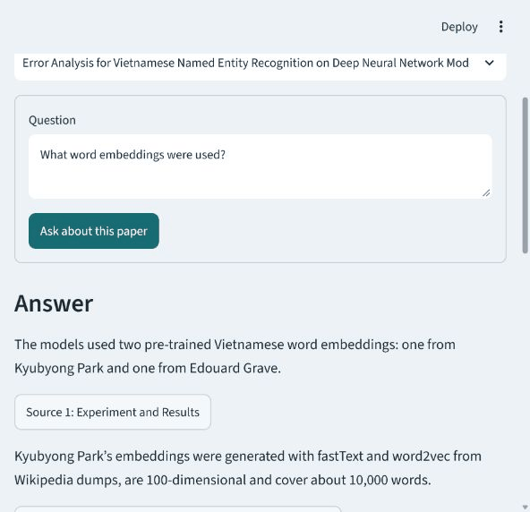
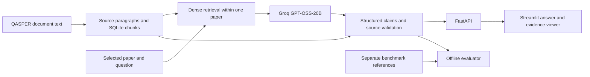

# PaperTrail

Ask a question about one research paper and inspect the passages behind the answer.
PaperTrail retrieves text from the selected paper, generates short claims with
Groq GPT-OSS-20B, and opens each citation in its original paragraph.

The first user is a researcher reading an unfamiliar English NLP paper. A valid
source location does not guarantee that the model interpreted the passage correctly.



This captured-frame demo replays a saved training-paper answer and simulated
refusal/error states; it makes no model calls. The saved answer used historical
hybrid retrieval. The selected application uses **Groq GPT-OSS-20B + dense retrieval**.
[Readable walkthrough](reports/demo/index.html) · [Demo instructions](docs/demo.md)

## How it works



Original paragraphs, stable IDs, and exact character spans survive chunking.
The API and offline evaluator reuse one answer pipeline. The UI calls the API;
it cannot silently choose another model, prompt, or retrieval configuration.
Storage starts with SQLite. PostgreSQL is planned for a later version.

## Add your own papers

Open **Add a paper** in the interface to upload a selectable-text PDF or import an
arXiv link. Preview the extracted text, edit its title, and click **Add to collection**.
The saved paper is selected immediately and remains available after a restart.
Limits: 20 MiB, 100 pages; scanned PDFs require OCR elsewhere. Page citations refer
to extracted text, whose reading order can differ from the PDF. Your collection is
stored separately from the benchmark assets. [Import guide](docs/paper_import.md).

## Local setup

Clone the repository, then run the setup commands below:

```powershell
git clone https://github.com/AryaZareizadeh/papertrail-research-assistant.git
cd papertrail-research-assistant
```

Use Python 3.13. The lock was reproduced on Windows/Python 3.13.0 and in a Linux
CPU container. From the repository root in PowerShell:

```powershell
python -m venv .venv
.\.venv\Scripts\python.exe -m pip install -r requirements.lock.txt
.\.venv\Scripts\python.exe -m pip install --no-deps --no-build-isolation -e .
.\.venv\Scripts\python.exe -m evidence_assistant.cli doctor
```

For Linux CPU use, install `torch==2.14.1` from
`https://download.pytorch.org/whl/cpu` with `--no-deps` first, then install the
remaining lock with `--no-deps`. Docker performs these steps automatically.
If bundled `ensurepip` is unavailable, `uv venv .venv` and `uv pip install --python
.venv\Scripts\python.exe ...` can perform the same installation. The bootstrap
lock supports only the earlier SQLite/BM25 milestone, not the full app.

Copy `.env.example` to the ignored `.env` file and set `GROQ_API_KEY` locally.
Never put a key in source code, a question, or Git. See [hosted setup](docs/hosted_model_setup.md).

For a fresh checkout, acquire and prepare assets explicitly:

```powershell
.\.venv\Scripts\python.exe -m evidence_assistant.cli download
.\.venv\Scripts\python.exe -m evidence_assistant.cli normalize
.\.venv\Scripts\python.exe -m evidence_assistant.cli prepare-tokenizer
.\.venv\Scripts\python.exe -m evidence_assistant.cli chunk
.\.venv\Scripts\python.exe -m evidence_assistant.cli prepare-embedding
.\.venv\Scripts\python.exe -m evidence_assistant.cli index
.\.venv\Scripts\python.exe -m evidence_assistant.cli prepare-generation-tokenizer
.\.venv\Scripts\python.exe -m evidence_assistant.cli calibrate-generation
```

Downloads are separate from startup. Initial calibration makes four hosted
training-prompt requests and saves token-accounting metadata; do not repeat it
for an already prepared, unchanged setup. Configuration paths resolve relative
to their YAML file.

Start the API and UI in separate terminals:

```powershell
.\.venv\Scripts\python.exe -m uvicorn evidence_assistant.api:app --host 127.0.0.1 --port 8000
.\.venv\Scripts\python.exe -m streamlit run src/evidence_assistant/ui.py --server.address 127.0.0.1 --server.port 8501
```

Open [the interface](http://127.0.0.1:8501) or [API docs](http://127.0.0.1:8000/docs).
`PAPERTRAIL_CONFIG` selects the API config; `PAPERTRAIL_API_URL` selects the UI's API
address. Search for a paper, ask a question, and click a source beside a claim.
Read surrounding text in the original paragraph. Insufficient evidence and service
failures are distinct states. [API contract](docs/api.md).

## Docker

With assets prepared and Docker Desktop's Linux engine running:

```powershell
.\.venv\Scripts\python.exe -m evidence_assistant.runtime_export --output runtime/artifacts
docker compose up --build -d
```

The CPU image excludes keys, datasets, weights, benchmark references, and private
logs. Compose mounts exported runtime assets read-only, logs separately writable,
and reads the ignored environment file at runtime. The UI uses `http://api:8000`.
Demo ports bind to localhost. [Container setup and shutdown](docs/containers.md).

## Evaluation

| Validation setup | Questions | Answer F1 | System/model errors | Warm p95 |
| --- | ---: | ---: | ---: | ---: |
| Groq + BM25 | 30 | 0.3285 | 0/30 | 4.26 s |
| Groq + dense, selected | 30 | 0.3917 | 0/30 | 2.93 s |
| Groq + hybrid | 30 | 0.3417 | 1/30 | 2.40 s |
| Nemotron Ultra, identical saved hybrid passages | 30 | 0.3818 | 5/30 | 5.93 s |

These are deterministic validation-pilot comparisons, not general model rankings.
Answer F1 is lexical overlap, not an accuracy percentage. Retrieval also compared
all 92 validation questions. Dense improved complete annotated-evidence coverage
slightly, with an extra false refusal in the answer slice. Nemotron showed some
quality gains but its free route failed the operational gate. The user chose Groq.

All 30 hybrid responses have an explicitly labeled agent audit accepted by the
user. Human claim-support scores remain unavailable. Example failures include
unsupported acronym expansion, confusing cognitive and stylistic features,
partial attribution, retrieval misses, and over-refusal despite usable evidence.
Clickable citations make these failures inspectable; they do not eliminate them.

The frozen held-out pilot is complete: **187/187 questions from 50 papers**
attempted, with 185 completed responses and 2 retained historical rate-limit failures.
The user authorized the final 33 unattempted cases; all original attempts were
preserved. Whole-pilot Answer F1 is **0.2600**, Evidence F1 **0.4374**;
strict text-only Answer F1 is 0.2938 on 149 questions.
Failures receive zero and remain in the denominator. This is a pilot, not the
full benchmark or an accuracy percentage. Peer feedback remains deferred.

[Final configuration and protocol](reports/evaluation.md) ·
[Baseline details](reports/evaluation_baseline.md) ·
[Model comparison](reports/model_comparison.md) ·
[Failure analysis](reports/failure_analysis.md) ·
[Usability status](reports/usability.md)

## Software checks and scope

```powershell
.\.venv\Scripts\python.exe -m ruff check .
.\.venv\Scripts\python.exe -m pytest -q
```

Regular checks use synthetic fixtures/fake responses. Hosted smoke tests are
separately enabled and disabled by default. CI uses no provider keys or model
downloads. The offline demo replays saved data with simulated refusal/error states.

Version one supports English paper text, including uploaded PDFs and arXiv imports.
OCR,
figure/table reasoning, Persian support, cross-paper synthesis, authentication,
and public multi-user hosting are future work. Hosted models can change or throttle;
the small pilot and public-benchmark contamination limit conclusions.

## Data, licenses, and contribution

QASPER v0.3 is supplied by Ai2; its [dataset card](https://huggingface.co/datasets/allenai/qasper)
lists CC BY 4.0. Cite [the QASPER paper](https://arxiv.org/abs/2105.03011).
The application code is MIT; data, model, provider, dependency, and vendored-code
terms are separate. [NOTICE](NOTICE) · [Data card](docs/data_card.md) ·
[Model card](docs/model_card.md).

The contribution is source-preserving ingestion/storage, controlled retrieval
comparison, a shared generation/citation boundary, transparent evaluation/audits,
an evidence viewer, and reproducible application packaging. It does not claim
training a new foundation model.

Raw data, weights, keys, and private run logs are ignored. Selected non-sensitive
examples and the recorded walkthrough are included. The
[checklist](reports/checklist_audit.md) and [experiment log](reports/experiment_log.md)
retain implementation decisions and limits.
