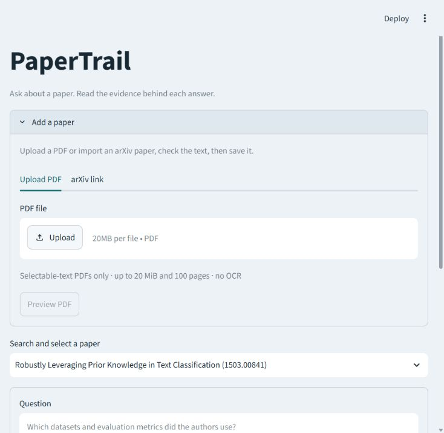

# PDF and arXiv import verification — 31 October 2026

Implemented selectable-text PDF uploads and arXiv link/ID import with extracted-text
preview, editable title, explicit confirmation, duplicate detection and immediate
paper selection. User papers use separate atomic SQLite/vector/PDF bundles in the
persistent library volume. The original corpus and evaluated configuration remain
available; existing pilot metrics are historical and do not measure this extension.

## Verified

- Windows offline suite: 186 passed, 2 opt-in hosted checks skipped.
- Linux CPU image, networking disabled, source/tests/lock/config mounted read-only:
  186 passed, 2 hosted checks skipped. The first harness omitted the lock/config
  mounts; those failures were fixture setup errors and passed after supplying them.
- Final UI limit/layout adjustment: 5 focused import/existing UI checks passed.
- Ruff passed, whitespace checks passed; all 83 installed packages compatible.
- Real arXiv sample `1706.03762` downloaded and extracted: 2,215,244 bytes,
  15 text-bearing pages, 39,496 extracted characters. Same flow passed in the browser
  against the rebuilt container; title edited to `Attention Is All You Need`, saved
  and automatically selected.
- Uploading the same real PDF through HTTP preview/confirmation reused the saved
  entry without changing its title. Collection: 85 original papers plus 1 imported.
- Original imported page text matches its stored SHA-256; the base runtime corpus
  SHA-256 stayed unchanged. Synthetic answer tests additionally verify exact-span
  citation routing through the shared answer pipeline for imported documents.
- Rebuilt/restarted both services; both healthy, API ready (200), imported paper
  persisted in the collection.
- Independent review found an inferred-path overlap gap; three cases reproduced
  the failure before the fix. Effective library path is now validated against all
  protected directories. Reviewer independently confirmed the fix and no remaining
  important findings.

## Limits

No hosted answer-generation smoke or new benchmark run was performed. Import
checks download public documents and perform local extraction/embedding only.
Scientific answer quality on imported documents remains unmeasured. OCR, PDF
region highlights, image/table reasoning and multi-process shared deployment are
outside scope. Ready BM25-only services need a prepared dense encoder for imports;
the selected application is dense. A single-process lock protects local commits.

The existing unrelated documentation/report edits and pending human-review labels
were preserved. No publication or Git push was performed. See
[the import guide](../docs/paper_import.md) for usage, limits and storage.

